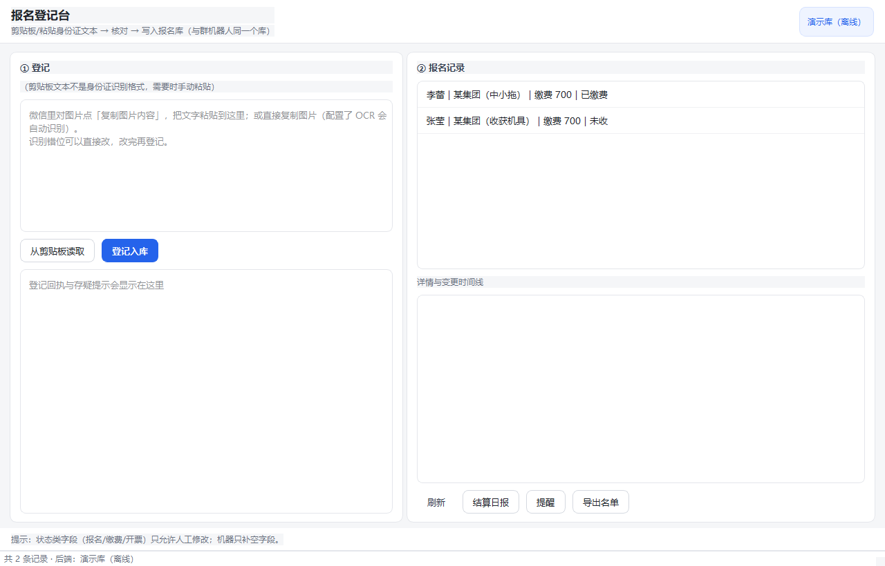
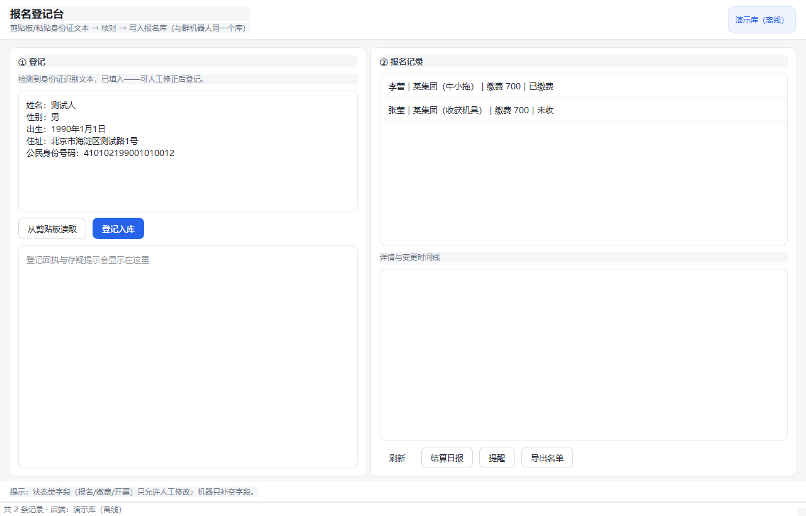
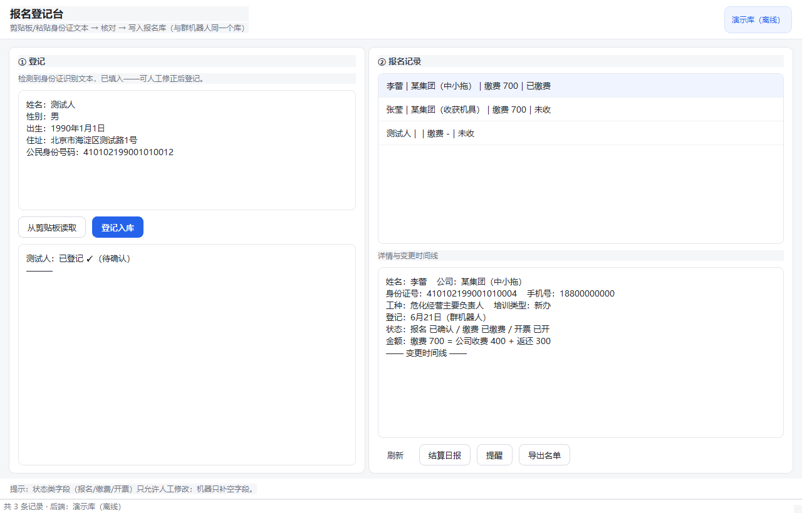
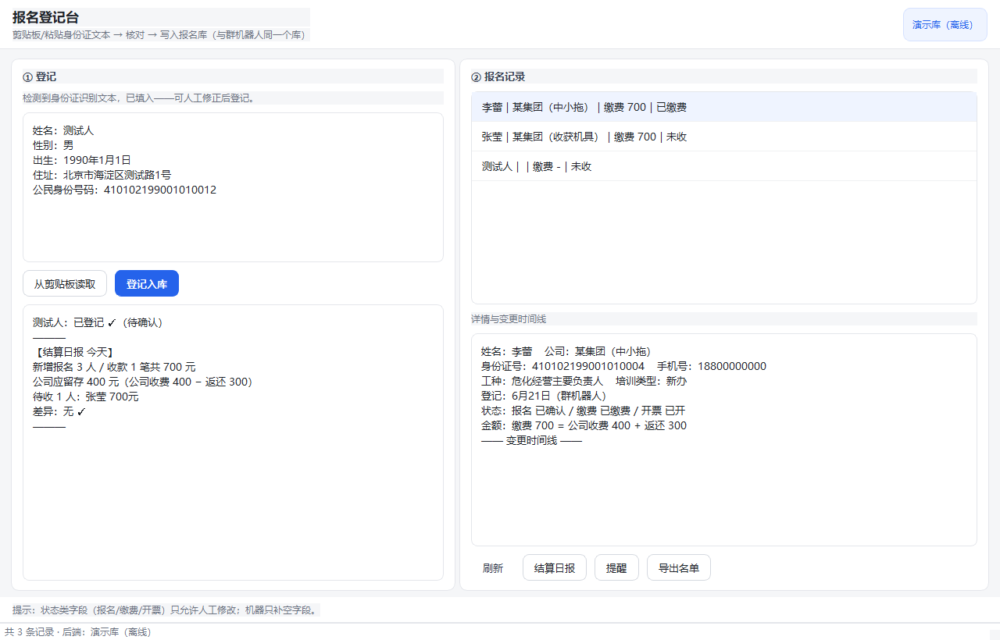

# EnrollPilot — 台账自动化

> 当前落地场景：安全培训报名结算。把业务员各自维护的 Excel 台账合并成一个在线主库。



## 业务背景

**从哪来**：2026 年 10 月，做安全培训报名结算的业务里，学员信息来自微信群里发来的身份证照片，
业务员各自维护自己的一张 Excel（总表 500+ 人），月底再把三张手工衍生表
（按期结算单 / 按集团名单 / 未参加培训名单）人肉拼出来对账。

**原来怎么做**：前台在群里收图 → 业务员把姓名、身份证、公司、工种、培训类型敲进 Excel →
群里口头通知"某某已缴费" → 月底对着一张张表核「缴费 = 公司收费 + 返还」。

**真正卡住的地方**：

- 数据散在多个业务员的 Excel 里，合不起来；系统里应该是一个库装所有人
- 公司名写法漂移：同一家单位会写成「某集团(柴油机)」「某集团（中小拖）」「某集团…收获机具公司」，
  括号全半角还不一样，对账时对不上
- 状态变更只存在于聊天记录，出了争议没有审计痕迹
- 结算有业务口径（协议价、公司留存、返还），手工算容易错

**所以做的不是"又一个报名表"**，而是把 Excel 台账整体搬上飞书多维表格当主库，
再把"改表"这件事规则化：

| 原来 | 现在 |
|---|---|
| 每人一张 Excel，月底合并 | 一个多维表格主库，双入口汇入 |
| 群里口头改状态 | 群指令改状态 + 字段级变更日志（谁、何时、旧值→新值） |
| 三张手工衍生表 | 名单 / 结算单 / 开票对账 一键导出 |
| 人工核算 | 按口径自动核对，超收、已退、价格偏离亮红灯 |

## 截图

**主界面**：左侧登记台（剪贴板 → 核对 → 入库），右侧报名记录与变更时间线。


**剪贴板登记**：微信里「复制图片内容」得到的身份证文本自动解析成结构化字段，识别错的地方可以直接改，改完再登记。



**变更时间线**：点任意一条记录，右侧显示该记录的字段级变更事实与结算拆分
（缴费 = 公司收费 + 返还）。



**结算日报**：新增报名 / 收款笔数 / 公司应留存 / 待收名单 / 差异红灯，一条指令出结果。



> 截图由 `tools/shoot_screenshots.py` 从真实窗口抓取（不修图），跑的是离线演示库；
> 其中姓名、身份证号、公司名均为脱敏后的测试数据。

## 它现在能干什么

入口 A（主，无人值守）：微信照片 →（转发）→ 飞书群 → 机器人收图 → OCR/LLM 抽取
→ 写/并 报名记录 → 群里回执卡片

入口 B（补充）：微信里复制图片 → 桌面工具自动读剪贴板 → OCR/LLM 清洗
→ 人眼预览 → 写同一张报名表（exe）

群里的指令：

- `张莹 已缴费 700` — 改状态 + 落收款流水 + 写变更日志（带旧值→新值）
- `记录 张莹` — 查该人的完整变更时间线
- `结算` — 结算日报（公司应留存 / 待收 / 差异红灯）
- `导出 名单 某集团` — 生成 Excel 发回会话
- `提醒` — 到期与未缴费提醒（班期以考试时间为准）
- `某集团还欠多少` — 规则式数据问答（欠款 / 人数 / 收款 / 状态）

离线看它跑（不联网、不需要凭据）：

```bash
.venv\Scripts\python tools\enroll_bot.py --demo
```

跑的是真实业务函数：种子数据 →「张莹 已缴费 700」→「李蕾 已退」→「记录 张莹」→「结算」。

## 项目结构

| 目录 | 内容 |
|---|---|
| `docs/报名结算系统-设计.md` | **唯一设计事实源**（数据模型/双入口/结算口径/分期） |
| `gateway/` | 飞书长连接接入（自 FormPilot 迁移：收消息、下载附件、多事件合并） |
| `core/` | 纯逻辑基建（自 FormPilot 迁移：身份证校验位、字典别名归一化） |
| `enroll/` | 业务层：`bitable.py` 多维表格客户端 / `bitable_store.py` bitable 后端存储 / `records.py` 幂等合并 / `extract.py` 文本抽取（微信交错文本/OCR）/ `intake.py` 登记入库 / `instructions.py` 群指令 / `settlement.py` 结算核对 / `export.py` Excel 导出 / `demo_store.py` 离线库 / `service.py`+`runner.py` 执行与编排 |
| `gui/desktop_tool.py` | 桌面登记台（入口B）：剪贴板双模式 → 人工修正 → 与机器人同库同路径 |
| `tools/enroll_bot.py` | CLI：`--demo` 离线闭环 / `--desktop` 桌面台 / `--listen` 真连长连接 / `--check-config` 配置体检 |
| `tools/setup_tables.py` | 一键建库：应用身份创建「报名结算」多维表格 + 五张表 + 字段，自动回填配置，`--smoke` 冒烟 |
| `tools/import_excel.py` | 真实 Excel（总表）→ 公司/班期/报名记录/收款四张表，`--limit` 试导、`--reset` 清空重导 |
| `tools/build_dictionaries.py` | 从真实 Excel 提取字典值域（工种/培训类型/人员类别/学历）→ `config/options_*.yaml` |
| `tools/shoot_screenshots.py` | 生成 README 截图（真实窗口 + 演示库） |
| `config/enroll.example.yaml` | 配置模板（正式 `enroll.yaml` 已 gitignore） |

## 快速开始

```bash
python -m venv .venv
.venv\Scripts\pip install -r requirements.txt
.venv\Scripts\python -m pytest tests/ -q     # 全部离线测试
.venv\Scripts\python tools\enroll_bot.py --demo
```

测试为**纯脚本双模式**：`python tests/test_xxx.py` 或 `pytest tests/` 均可，
不依赖网络与凭据。

## 实施阶段

- **M1（离线地基 ✅ + 真连联调 ✅）**：bitable 客户端与后端存储 / 记录幂等合并 / 微信交错文本
  抽取（交叉核对只报警）/ 群指令 / 结算核对 / 收消息编排（`--listen`）——已在真实团队租户完成：
  应用发布（长连接 + 收消息事件 + 4 项权限）、`setup_tables.py` 建五张表、冒烟测试、
  真实后端端到端（登记→收款→变更日志→时间线→结算）全部通过。**注意：飞书个人版
  （`*.user.feishu.cn`）按平台策略不开放自建应用 API（21001），必须用团队/企业租户。**
- **M2（桌面入口 ✅）**：`--desktop` 剪贴板双模式登记台，与机器人同库同路径；**exe 已打包**
  （`dist/EnrollPilot/EnrollPilot.exe`，`ENROLLPILOT_SMOKE=1` 自检退出码 0；外观交互待真机人工验证）
- **M3（群内状态变更 ✅）**：群指令改状态已实弹验证（缴费/开票，回执带旧值→新值），
  变更日志落库，群内「记录 <姓名>」查时间线；卡片渲染未做（当前为文本回复）
- **M4（导出 ✅ + 推送 ✅）**：`export_settlement` 按期结算单 / `export_roster` 按集团·状态名单；
  群指令「导出 名单/结算」直接生成 Excel 发到会话；每日 18:30 自动推送日报（`settlement.push_chat_id`）
- **P2（提醒/问答/卡片 ✅）**：班期驱动提醒（**以考试时间为准**：考试前一天发名单 + 报名 N 天未缴费），
  「提醒」指令即时查、日报自动附带；规则式数据问答（欠款/人数/收款/状态）；日报/提醒/查询用飞书卡片渲染
- **OCR（✅ 腾讯云）**：身份证图片 → 腾讯云 OCR（自包含 TC3 签名，无重 SDK）→ 标签文本 → 同一抽取管道；
  密钥配在 `config/enroll.yaml → ocr`，未配置时自动回落「复制图片内容」文本兜底
- **数据装载（✅）**：`build_dictionaries.py` 提取真实字典值域；`import_excel.py` 把 516 行总表导入
  公司（114 家）/班期（60 期，考试日期并入班期）/报名记录（512）/收款（405），并种子**收费标准表**
  （22 条统一价，历史价格冲突写进备注）；复审到期按「参加日期 + 3 年」推算（表内有值优先）。
  结算新增**价格偏离红灯**：公司收费 ≠ 标准价（工种×培训类型）即提示；收款按记录 ID 归组（重名安全）。

## 合规边界

只走飞书官方 API，**绝不 hook 个人微信**（微信只做"复制/转发"一步人肉搬运）；
身份证等证件照本地处理；变更日志只记字段级事实；提交/收款的真实资金动作永远由人完成。
